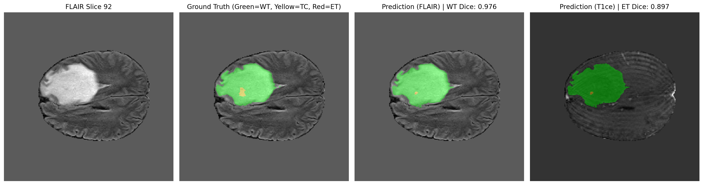
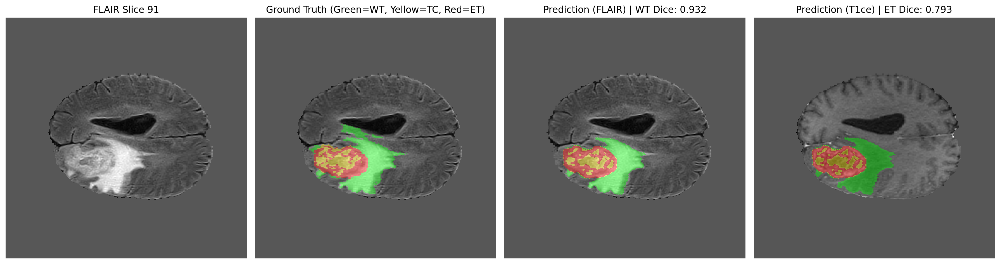
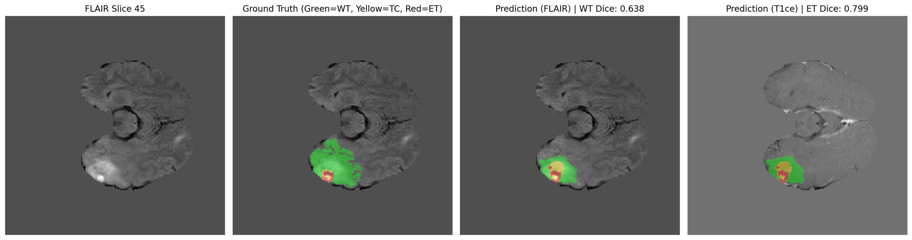
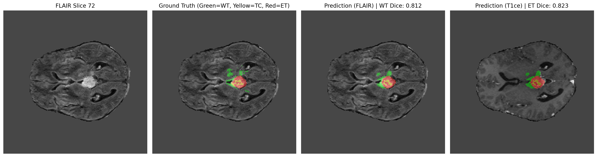
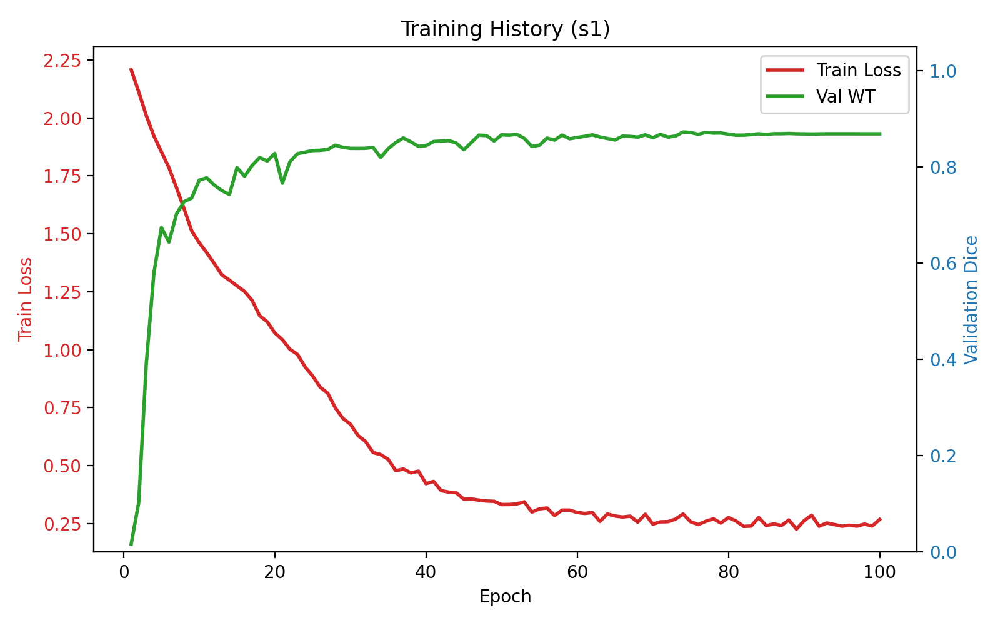
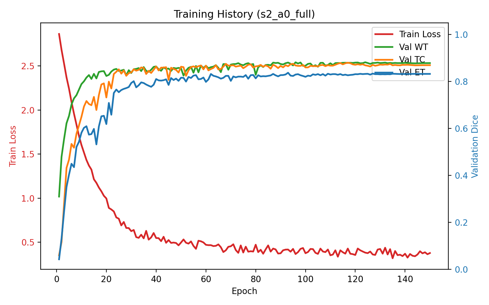

# Coarse-to-Fine 3D Brain Tumor Segmentation
**Attention-Dilated ResNet U-Net with a Transformer Bottleneck**

[](https://www.python.org/)
[](https://pytorch.org/)
[](tests/test_smoke.py)
[](https://www.med.upenn.edu/cbica/brats2020/)
[](LICENSE)

**Course:** CS3006 Introduction to Data Science for Engineers  
**Faculty:** Dr. Jagadeesh Kakarla  
**Team 12 (IIITDM Kancheepuram):** Narayana Murthy S, Piyush Mishra, Ankush R, Vihaan Gupta  

---

## Architecture Overview

A lightweight, two-stage coarse-to-fine 3D segmentation pipeline combining complementary ideas from three surveyed papers:
1. **Zhu et al. (2024):** ResNet encoder blocks with CBAM (Convolutional Block Attention Module) skip attention and composite Dice + BCE loss.
2. **Guan et al. (2023):** 3D Kernel-sharing dilated convolutions in deep stages 3 and 4 for multi-scale receptive field expansion without multiplying parameters.
3. **Zhang et al. (2024):** Transformer bottleneck (2 layers) with conditional depthwise positional encoding for global context at 1/16 resolution.

### Two-Stage Coarse-to-Fine Pipeline Flow
1. **Stage 1 (`CoarseNet`):** Light 3D U-Net (base 8 channels, 0.36M params) operates on the full volume downsampled 2× (120 × 120 × 80 voxels) to predict Whole Tumor (WT). At inference, probabilities are upsampled, thresholded at 0.5, filtered for the largest connected component, and expanded with a 12-voxel safety margin (minimum crop size 64).
2. **Stage 2 (`FineNet`):** Full-resolution multi-label network (base 16 channels, 9.27M params) segments the localized 128³ patch into Whole Tumor (WT), Tumor Core (TC), and Enhancing Tumor (ET), strictly enforcing anatomical nesting: `ET ≤ TC ≤ WT`.

---

## Key Performance Results

Evaluated on the held-out test split of BraTS 2020 ($N=27$ patients, seed 0, strict patient-wise separation):

### Primary Segmentation Accuracy
| Region | Dice (Mean ± Std) | Median Dice | 95% Hausdorff Distance (HD95) |
|:---|:---:|:---:|:---:|
| **Whole Tumor (WT)** | **0.9127 ± 0.065** | **0.9321** | **2.76 ± 2.46 mm** |
| **Tumor Core (TC)** | **0.8994 ± 0.112** | **0.9349** | **2.82 ± 3.54 mm** |
| **Enhancing Tumor (ET)** | **0.8488 ± 0.088** | **0.8663** | **1.53 ± 1.04 mm** |

### System Efficiency & Localization Diagnostics
| Metric | Value | Practical / Clinical Significance |
|:---|:---:|:---|
| **Inference Latency** | **0.388 s / volume** | **2.58 volumes/second** throughput on a single Tesla T4 GPU |
| **Peak GPU VRAM** | **818.1 MB** | 19.8× lower than 16GB limit; runnable on 2GB consumer laptop GPUs |
| **Model Parameters** | **9.63 M total** | Stage 1: 0.36M params; Stage 2: 9.27M params |
| **Stage 1 WT Recall** | **95.11% ± 5.04%** | Captures 95.1% of all ground-truth tumor voxels inside predicted box |
| **Stage 1 Detection Rate** | **100% (0 / 27 missed)** | Zero false-negative brain scans across the entire test set |
| **S1 Box Containment** | **74.07% (20 / 27)** | 74.1% of cases have 100% of tumor fully enclosed in Stage 1 crop |

> **Full Project Report:** For complete experimental details, full statistical distributions, and failure analysis, see [**REPORT.md**](REPORT.md).

---

## Controlled Ablation Study (A0 – A7)

| ID | Configuration | WT Dice | TC Dice | ET Dice | WT HD95 | Latency | Peak VRAM | Params |
|:---|:---|:---:|:---:|:---:|:---:|:---:|:---:|:---:|
| **A0** | **Full Proposed Model** | **0.9127** | 0.8994 | 0.8488 | **2.76 mm** | 0.39s | 818 MB | 9.27M |
| **A1** | Attention Gate skip connections | 0.9058 | **0.9145** | **0.8555** | 3.35 mm | 0.35s | 818 MB | 9.28M |
| **A2** | No skip attention (Standard U-Net) | 0.8995 | 0.9067 | 0.8403 | 3.88 mm | 0.33s | **761 MB** | 9.26M |
| **A3** | No Transformer bottleneck (`tf_layers=0`) | 0.9074 | 0.8896 | 0.8370 | 2.91 mm | 0.37s | 812 MB | 8.20M |
| **A4** | No dilated convolutions | 0.9077 | 0.8852 | 0.8284 | 2.85 mm | 0.37s | 802 MB | **6.81M** |
| **A5** | No modality dropout (`moddrop=0.0`) | 0.9090 | 0.9103 | 0.8343 | 2.81 mm | 0.37s | 818 MB | 9.27M |
| **A6** | No boundary loss term (`w_bd=0.0`) | 0.9069 | 0.8818 | 0.8349 | 3.16 mm | 0.38s | 818 MB | 9.27M |
| **A7** | Single-stage baseline (No CoarseNet) | 0.8086 | 0.8027 | 0.7715 | 26.22 mm | 0.73s | 3,123 MB | 9.27M |

### Key Takeaways:
- **Decisive Coarse-to-Fine Advantage (A0 vs A7):** Removing Stage 1 causes WT Dice to drop by **10.4%**, boundary error (HD95) to explode by **9.5×** (2.76 mm → 26.22 mm), latency to double, and memory to surge by **3.8×** (3,123 MB).
- **Missing Modality Defense (A0 vs A5):** When FLAIR is omitted at inference time, model A0 (trained with modality dropout) preserves **0.8525 WT Dice**, whereas model A5 (without modality dropout) collapses to **0.6805** (a **17.2% drop**).

---

## Qualitative Results

Visual segmentation outputs on held-out test patients. Color key: **Green = Peritumoral Edema (WT \ TC)**, **Yellow = Necrotic Core (TC \ ET)**, **Red = Enhancing Tumor (ET)**.

| Case Type | Qualitative 4-Panel Overlay | Key Metrics |
|:---|:---:|:---|
| **Best Case** (`BraTS20_Training_098`) |  | WT Dice: **0.976** \| TC Dice: **0.959** \| ET Dice: **0.897** \| HD95: **1.0 mm** |
| **Median Case** (`BraTS20_Training_006`) |  | WT Dice: **0.932** \| TC Dice: **0.928** \| ET Dice: **0.793** \| HD95: **3.0 mm** |
| **Worst Case** (`BraTS20_Training_158`) |  | WT Dice: **0.693** \| TC Dice: **0.426** \| ET Dice: **0.735** \| HD95: **12.1 mm** |
| **S1 Failure** (`BraTS20_Training_082`) |  | WT Dice: **0.812** \| TC Dice: **0.914** \| ET Dice: **0.823** (Box truncated peripheral edema) |

---

## Training History

| Stage 1: CoarseNet (100 Epochs) | Stage 2: FineNet A0 Full Model (150 Epochs) |
|:---:|:---:|
|  |  |

---

## Repository Structure

```
idse-project/
├── idse-project.ipynb        # Fully executed Kaggle notebook with rendered cell outputs
├── REPORT.md                 # Detailed project report, literature comparison & failure analysis
├── README.md                 # This overview and reproduction guide
├── models.py                 # CoarseNet, FineNet, CBAM, Attention Gates, Dilated Convs, Transformer
├── data.py                   # Data caching, memory-mapped I/O, dataset loaders, modality dropout
├── losses.py                 # Soft Dice, Binary Cross-Entropy, Soft Boundary-Dice loss
├── train.py                  # PyTorch AMP training engine with OneCycleLR scheduler
├── infer.py                  # Two-stage & single-stage inference engine (HD95, latency, peak VRAM)
├── requirements.txt          # Minimal pinned dependencies
├── tests/
│   └── test_smoke.py         # 7 unit tests (forward passes, shapes, gradients, boundary cases)
├── scripts/
│   ├── run_kaggle_pipeline.py# Master end-to-end automated runner (data, training, ablations, zipping)
│   ├── run_advanced_eval.py  # Master evaluation engine for A (Generalization), B (Adaptive Margin), C (TTA)
│   ├── visualize_results.py  # Generates training curves and 4-panel qualitative overlays
│   └── make_synthetic_cache.py # Synthetic cache generator for offline dry runs
└── results/                  # All evaluation CSVs, training curves, and qualitative PNG overlays
```

---

## Quickstart & Reproducibility

### 1. Installation
```bash
git clone https://github.com/pengeon1/idse-project.git
cd idse-project
python3 -m venv .venv && source .venv/bin/activate
pip install -r requirements.txt
```

### 2. Verify Unit Tests
```bash
python -m pytest tests/test_smoke.py -v
```

### 3. Run Preprocessing & Master Pipeline (End-to-End)
```bash
python scripts/run_kaggle_pipeline.py \
    --raw_dir /path/to/MICCAI_BraTS2020_TrainingData \
    --work_dir . \
    --max_cases 180 \
    --s1_epochs 100 \
    --s2_epochs 150 \
    --ablation_epochs 60 \
    --batch_size 2
```

Or open and run [**`idse-project.ipynb`**](idse-project.ipynb) directly in Kaggle with a GPU T4 accelerator enabled.

---

## Citation
```bibtex
@misc{cfseg2026,
  title={Coarse-to-Fine 3D Brain Tumor Segmentation with Attention-Dilated ResNet U-Net and Transformer Bottleneck},
  author={Murthy, Narayana and Mishra, Piyush and Ankush, R. and Gupta, Vihaan},
  institution={IIITDM Kancheepuram},
  year={2026}
}
```
